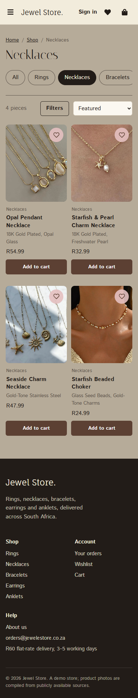
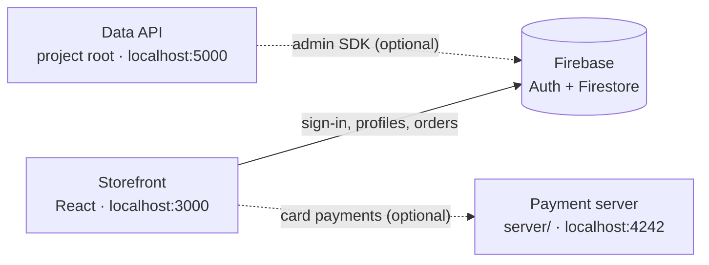

# 💎 Jewel eStore

An online jewellery store built with **React**, **Firebase** and **Stripe**, with the UI first designed in Figma.
Shoppers can browse rings, necklaces, bracelets, earrings and anklets, save favourites, check out by card or EFT, and follow their orders. Store admins can manage orders from a dashboard.

Built by **Web Innovation Nexus (WIN)**, a student tech team from North West, South Africa, as a portfolio-grade store for small and medium jewellery brands.

<p>
  
  &nbsp;
  
</p>

---

## Contents

- [Quick start](#-quick-start)
- [Try it out](#-try-it-out)
- [Features](#-features)
- [How it fits together](#-how-it-fits-together)
- [Running the backends](#-running-the-backends)
- [Configuration](#-configuration)
- [Admin access](#-admin-access)
- [Project structure](#-project-structure)
- [Troubleshooting](#-troubleshooting)
- [Team](#-team)
- [License](#-license)

---

## 🚀 Quick start

You need [Node.js](https://nodejs.org/) 18 or newer.

```bash
git clone https://github.com/phemelomakgopa/Jewel-eStore.git
cd Jewel-eStore/client
npm install
npm start
```

Open **http://localhost:3000**.

That's the whole store. Accounts, orders and the admin panel work straight away, and payments run in demo mode. You don't need either backend server to use it.

---

## 🧪 Try it out

| To try | Do this |
| --- | --- |
| A successful card payment | Card `4242 4242 4242 4242`, any future expiry date, any CVC |
| A declined card | Card `4000 0000 0000 0002` |
| Bank transfer | Choose **Bank transfer (EFT)** at checkout. You get bank details and a payment reference. |
| 10% off | Code `WELCOME10` |
| 20% off | Code `SAVE20` (subtotal over R100) |
| Free delivery | Code `FREESHIP` (subtotal over R50) |

In demo mode no money changes hands. The checkout labels it clearly.

---

## ✨ Features

**Shopping**
- One shop page for browsing and search, with category, material, price and stock filters
- Filters live in the web address, so results can be shared or bookmarked and the Back button works
- Search suggestions that jump straight to a product or a category
- Product pages with stock levels, reviews and ratings, and similar pieces
- Per-account wishlist

**Buying**
- Cart that survives page reloads, respects stock limits and takes discount codes
- Checkout that remembers your delivery address
- Card payment through Stripe (or demo mode), or bank transfer (EFT)
- Order confirmation by email, and an order history with live status

**Accounts and admin**
- Email/password and Google sign-in that returns you to the page you were on
- Admin panel to see every order and update its status. Customers see the change in their order history.

**Everywhere**
- Works on phones: menu drawer, swipeable categories and a slide-over filter panel
- Keyboard and screen-reader friendly: visible focus, labelled controls, skip link

---

## 🧭 How it fits together



| Part | Folder | Port | Needed? |
| --- | --- | --- | --- |
| Storefront | `client/` | 3000 | **Yes.** This is the website. |
| Payment server | `server/` | 4242 | Only for real Stripe card payments |
| Data API | project root | 5000 | No. The storefront doesn't call it; it's a REST API for other tools. |

The storefront talks to Firebase directly from the browser, so accounts, orders and the admin panel work without running any server of your own.

---

## 🖥 Running the backends

### Payment server (real card payments)

1. In the [Stripe dashboard](https://dashboard.stripe.com/test/apikeys), copy your **test** keys.
2. Create `server/.env`:
   ```
   STRIPE_SECRET_KEY=sk_test_...
   ```
3. Create `client/.env.local`:
   ```
   REACT_APP_STRIPE_PUBLISHABLE_KEY=pk_test_...
   ```
4. Start the server in its own terminal:
   ```bash
   cd server
   npm install
   npm start
   ```
   It prints `Node server listening on port 4242`.
5. Restart the storefront (`Ctrl+C`, then `npm start` in `client/`). Checkout now uses Stripe instead of demo mode.

### Data API (optional)

1. In the Firebase console, open **Project settings → Service accounts → Generate new private key**.
2. Save the file as `serviceAccountKey.json` in the project root. It's gitignored, so it is never committed.
3. From the project root:
   ```bash
   npm install
   npm run dev
   ```
4. Check it at http://localhost:5000/api/test.

| Endpoint | Returns |
| --- | --- |
| `GET /api/test` | Health check |
| `GET /api/products` | All products in Firestore |
| `GET /api/products/:id` | One product |
| `GET /api/orders` | All orders |
| `POST /api/orders` | Creates an order from `{ user, items }` |

Without a key the API still starts, but the product and order endpoints answer `503`.

---

## ⚙️ Configuration

All settings are optional. Each folder has an `.env.example` to copy from.

| File | Variable | What it does |
| --- | --- | --- |
| `client/.env.local` | `REACT_APP_STRIPE_PUBLISHABLE_KEY` | Turns on real Stripe payments |
| | `REACT_APP_PAYMENT_API_URL` | Payment server address (default `http://localhost:4242`) |
| | `REACT_APP_EMAILJS_SERVICE_ID`, `_TEMPLATE_ID`, `_PUBLIC_KEY` | Use your own EmailJS account for confirmation emails |
| | `REACT_APP_FIREBASE_*` | Point the store at a different Firebase project |
| `server/.env` | `STRIPE_SECRET_KEY` | Stripe secret key for creating payments |
| `.env` (root) | `PORT` | Data API port (default 5000) |
| | `FIREBASE_SERVICE_ACCOUNT` | Path to the service-account key, if it isn't in the project root |

### Firestore rules

`firestore.rules` contains the security rules the store expects: customers can only read and edit their own profile and orders, and admins can read every order and change its status. Deploy them with:

```bash
firebase deploy --only firestore:rules
```

---

## 🔑 Admin access

1. Add the person's email address to `client/src/config/adminList.js`, and to the matching list in `firestore.rules`. Redeploy the rules afterwards.
2. They sign in as normal. **Admin dashboard** appears in their account menu.

The dashboard is at `/admin`. Order management is at `/adminpanel`.

---

## 🧱 Project structure

```
Jewel-eStore/
├── client/                    # The storefront (React)
│   ├── public/                # index.html, icons, manifest
│   └── src/
│       ├── assets/            # Product photos, video, logo
│       ├── components/        # Pages and UI: Shop, ProductDetails, Cart, Checkout…
│       ├── config/            # Firebase config, admin list
│       ├── contexts/          # Shared state: auth, cart, wishlist, reviews, admin, toasts
│       ├── data/products.js   # The product catalogue
│       ├── utils/             # Price formatting, catalogue filters, sign-in messages
│       ├── App.jsx            # Routes
│       └── index.css          # Brand colours, fonts and shared styles
├── server/                    # Stripe payment server
├── config/, controllers/,     # Data API
│   middleware/, routes/,
│   index.js
├── docs/                      # README screenshots
└── firestore.rules            # Firestore security rules
```

### Adding or editing products

Every page reads from `client/src/data/products.js`.

1. Add the photo to `client/src/assets/`.
2. Import it at the top of `products.js`.
3. Add an entry with a new `id`. Prices are whole cents, so `5499` means R54.99.

### Tests

```bash
cd client
npm test
```

---

## 🛠 Troubleshooting

| Problem | Fix |
| --- | --- |
| Blank page at `localhost:5000` | That's the data API, not the website. Open **http://localhost:3000** (run `npm start` in `client/`). |
| `Cannot find module ...serviceAccountKey.json` | You're running an old version of the data API. Pull the latest code, or add the key as described in [Data API](#data-api-optional). The storefront doesn't need it. |
| Checkout says **Demo mode** | Expected without Stripe keys. See [Payment server](#payment-server-real-card-payments). |
| "We couldn't reach the payment service" | The payment server isn't running. Start it with `npm start` in `server/`. |
| Admin orders say Firestore rules don't allow access | Deploy `firestore.rules`, and check the email is in both admin lists. |
| `Something is already running on port 3000` | Another copy of the store is open. Close that terminal, or answer `Y` to use another port. |

---

## 👥 Team

| Team member | Role | Contribution |
| --- | --- | --- |
| **Shaun Makgopa** | Project Lead & Full-Stack Developer | Led project planning, system architecture, deployment & frontend-backend integration |
| **Lethabo Manamela** | Backend Developer | Developed backend logic, APIs, and handled data management and server-side integration |
| **Queen Mohlala** | Frontend Developer | Built responsive UI layouts, reusable components, and interactive user interface elements |
| **Kevin Mbolongwe** | Frontend Developer | Enhanced UI/UX, implemented features, and optimized site responsiveness & performance |
| **Thapelo Fortuin** | React Developer (Admin Panel) | Created the Admin Dashboard for product & user management using React |

### 🏢 Studio

Developed under **Web Innovation Nexus (WIN)**, *where innovation meets simplicity.*

🌐 https://webinnovationnexus.com
📧 hello@webinnovationnexus.com

---

## 📜 License

Released under the MIT License: free to use, modify and share with attribution.

Product photos are compiled from publicly available sources for demonstration only.
